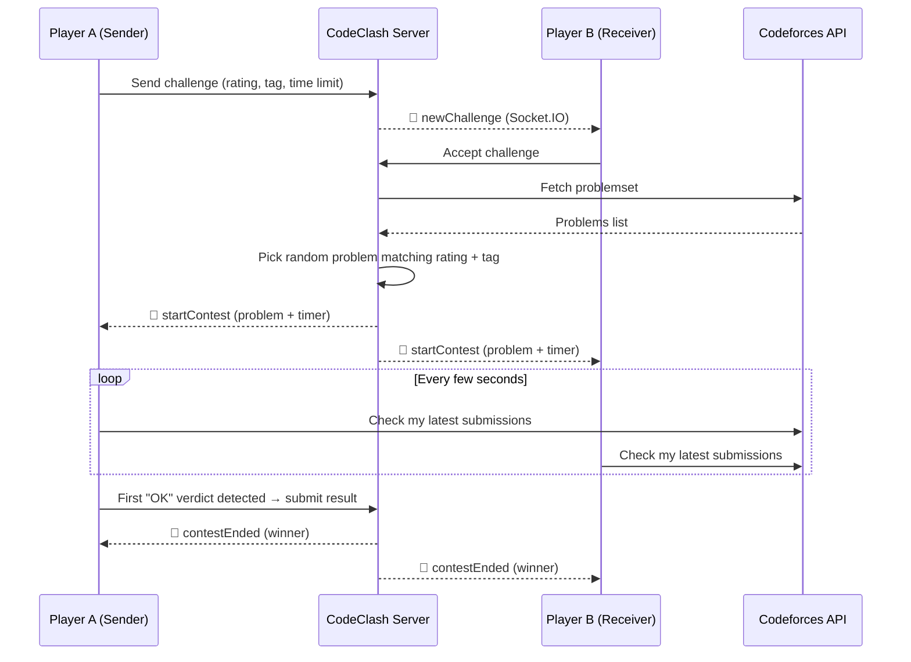

<div align="center">


# ⚔️ CodeClash

### One Problem. Two Minds. Winner Takes All.

**Real-time 1v1 competitive programming duels, powered by live Codeforces verdicts.**

<br/>

[](https://codeclash.vercel.app)


<br/>

<span style="color:#ef4444"><b>Code</b></span>. <span style="color:#facc15"><b>Compile</b></span>. <span style="color:#4ade80"><b>Conquer</b></span>.

</div>

---

## 📖 About

**CodeClash** turns solo problem-solving into a head-to-head sport. Challenge a friend by username, pick a Codeforces **rating** and **topic tag**, set a **time limit**, and race to get the first *Accepted* verdict.

No manual result entry, no trust issues. CodeClash watches your real Codeforces submissions and declares the winner automatically.

---

## ✨ Features

| | Feature | What it does |
|---|---|---|
| 🥊 | **Challenge Friends** | Start a 1v1 duel instantly by entering your friend's username |
| 🎯 | **Custom Battles** | Choose problem rating (800 → 3500), topic tag, and time limit |
| 🔔 | **Real-Time Invites** | Challenges pop up live via Socket.IO, with accept / reject / withdraw |
| ⏱️ | **Synced Timers** | Countdown starts only when the problem is assigned, so it's fair for both players |
| ✅ | **Auto Verdict Detection** | Polls the Codeforces API and declares the winner from real submissions |
| 🛡️ | **Earliest-AC Tie-break** | If two results clash, the earlier accepted submission wins |
| 📜 | **Match History** | Review past duels, wins, and matches played on your profile |
| 🔐 | **Secure Auth** | JWT authentication with bcrypt-hashed passwords |
| 🖼️ | **Profile Pictures** | Avatar uploads handled through Cloudinary |

---

## 🧠 How It Works



---

## 🛠️ Tech Stack

**Frontend**
- React 19 + Vite
- Tailwind CSS (custom dark theme with Roboto Mono)
- Redux Toolkit for state, React Router for navigation
- Socket.IO Client, Axios, React Toastify, Lucide Icons, Swiper

**Backend**
- Node.js + Express 5 (ES Modules)
- MongoDB + Mongoose
- Socket.IO for real-time events
- JWT + bcryptjs for authentication
- Multer + Cloudinary for image uploads

**Integrations**
- [Codeforces API](https://codeforces.com/apiHelp) for problems and submission verdicts

---

## 📁 Project Structure

```
CodeClash/
├── backend/
│   ├── config/          # MongoDB + Cloudinary setup
│   ├── middleware/      # JWT auth, file upload
│   ├── models/          # User, Challenge schemas
│   ├── routes/          # auth.js, challenge.js
│   ├── utils/           # getRandomProblem (Codeforces)
│   ├── socket.js        # Socket.IO events
│   └── server.js        # App entry point
│
└── frontend/
    ├── public/
    └── src/
        ├── api/         # Axios instance
        ├── components/  # Navbar, Hero, Features, Modals...
        ├── pages/       # Landing, Login, Signup, Dashboard, Contest, History
        ├── redux/       # Store + user slice
        └── App.jsx
```

---

## 🚀 Getting Started

### Prerequisites

- [Node.js](https://nodejs.org/) v18+
- A [MongoDB](https://www.mongodb.com/atlas) database (Atlas or local)
- A [Cloudinary](https://cloudinary.com/) account (for profile pictures)

### 1. Clone the repository

```bash
git clone https://github.com/<your-username>/CodeClash.git
cd CodeClash
```

### 2. Set up the backend

```bash
cd backend
npm install
```

Create a `.env` file inside `backend/`:

```env
PORT=5000
MONGODB_URI=your_mongodb_connection_string
JWT_SECRET=your_super_secret_key

CLOUDINARY_CLOUD_NAME=your_cloud_name
CLOUDINARY_API_KEY=your_api_key
CLOUDINARY_API_SECRET=your_api_secret
```

Start the server:

```bash
npm run dev
```

### 3. Set up the frontend

```bash
cd ../frontend
npm install
npm run dev
```

> **💡 Running locally?** Two values are currently pointed at the deployed app. Update them to use your local server:
> - `frontend/src/api/axios.js` → set `baseURL` to `http://localhost:5000/api`
> - `frontend/src/App.jsx` → set the `io(...)` URL to `http://localhost:5000`
> - `backend/server.js` → add `http://localhost:5173` to the CORS `origin`

The app will be live at **http://localhost:5173** 🎉

---

## 🔌 API Reference

### Auth — `/api/auth`

| Method | Endpoint | Description | Auth |
|---|---|---|:---:|
| `POST` | `/register` | Create an account (with optional profile picture) | ❌ |
| `POST` | `/login` | Log in and receive a JWT | ❌ |
| `GET` | `/profile` | Get the logged-in user's profile | ✅ |

### Challenges — `/api/challenge`

| Method | Endpoint | Description | Auth |
|---|---|---|:---:|
| `POST` | `/send` | Send a challenge to a user | ✅ |
| `GET` | `/received` | Pending challenges sent to you | ✅ |
| `GET` | `/ongoing` | Your active duels | ✅ |
| `GET` | `/my` | Every challenge involving you | ✅ |
| `GET` | `/:id` | Details of one challenge | ✅ |
| `POST` | `/:id/accept` | Accept a challenge and start the contest | ✅ |
| `POST` | `/:id/reject` | Reject a challenge | ✅ |
| `DELETE` | `/:id/withdraw` | Withdraw a pending challenge | ✅ |
| `POST` | `/:id/submit-result` | Record the winner or a draw | ✅ |

### Socket.IO Events

| Event | Direction | Purpose |
|---|---|---|
| `registerUser` | Client → Server | Join your personal room to receive invites |
| `joinChallenge` | Client → Server | Join a contest room |
| `newChallenge` | Server → Client | Live challenge invitation |
| `startContest` | Server → Client | Problem + timer for both players |
| `submitResult` | Client → Server | Announce a winner or draw |
| `contestEnded` | Server → Client | Final result broadcast |

---

## 🗺️ Roadmap

- [ ] Leaderboard and global rankings
- [ ] Rating system (Elo-style) for duels
- [ ] Friends list and challenge links
- [ ] Spectator mode
- [ ] Support for AtCoder / LeetCode problems

---

## 🤝 Contributing

Contributions, issues, and feature requests are welcome!

1. Fork the project
2. Create your feature branch: `git checkout -b feature/amazing-feature`
3. Commit your changes: `git commit -m "Add amazing feature"`
4. Push to the branch: `git push origin feature/amazing-feature`
5. Open a Pull Request

---

## 👨‍💻 Author

<div align="center">

**Sahil Chhillar**

[](https://github.com/<your-username>)
[](https://linkedin.com/in/<your-linkedin>)

<br/>

*Made with ❤️‍🔥 and ☕*

⭐ **If you enjoyed CodeClash, drop a star. It really helps!** ⭐

</div>
